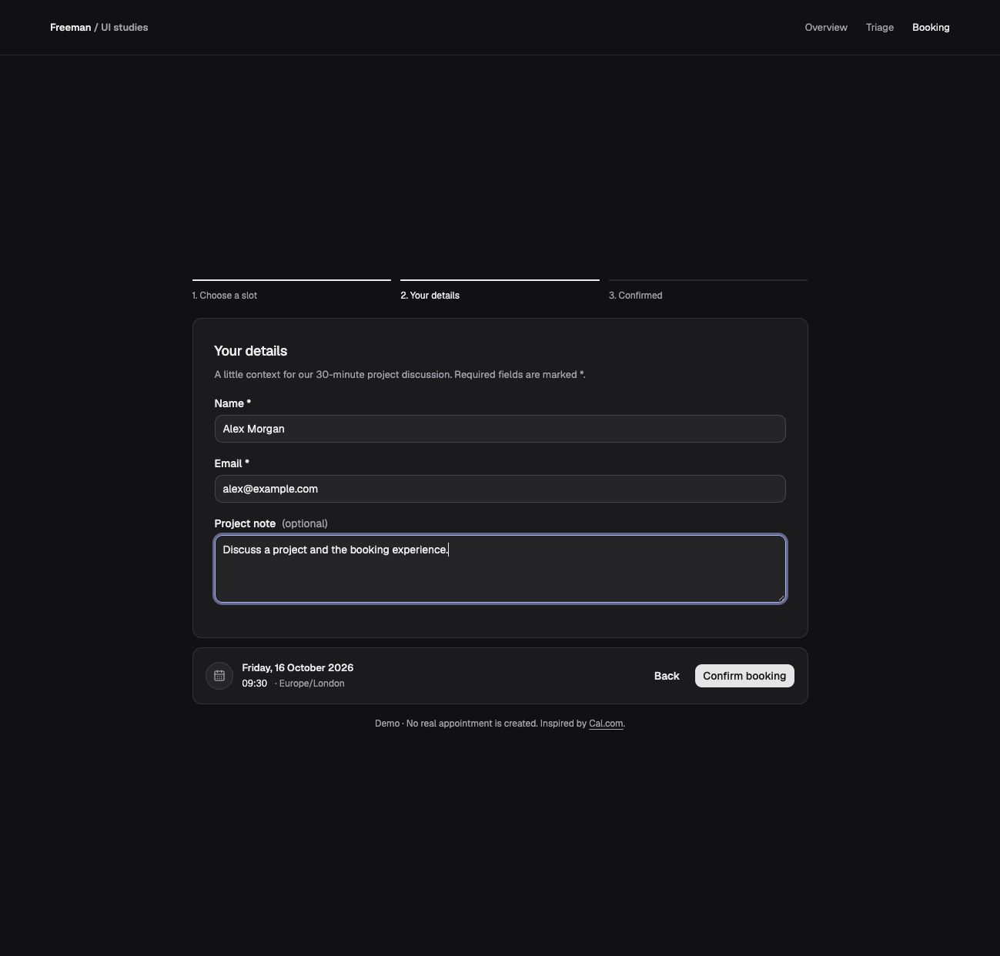
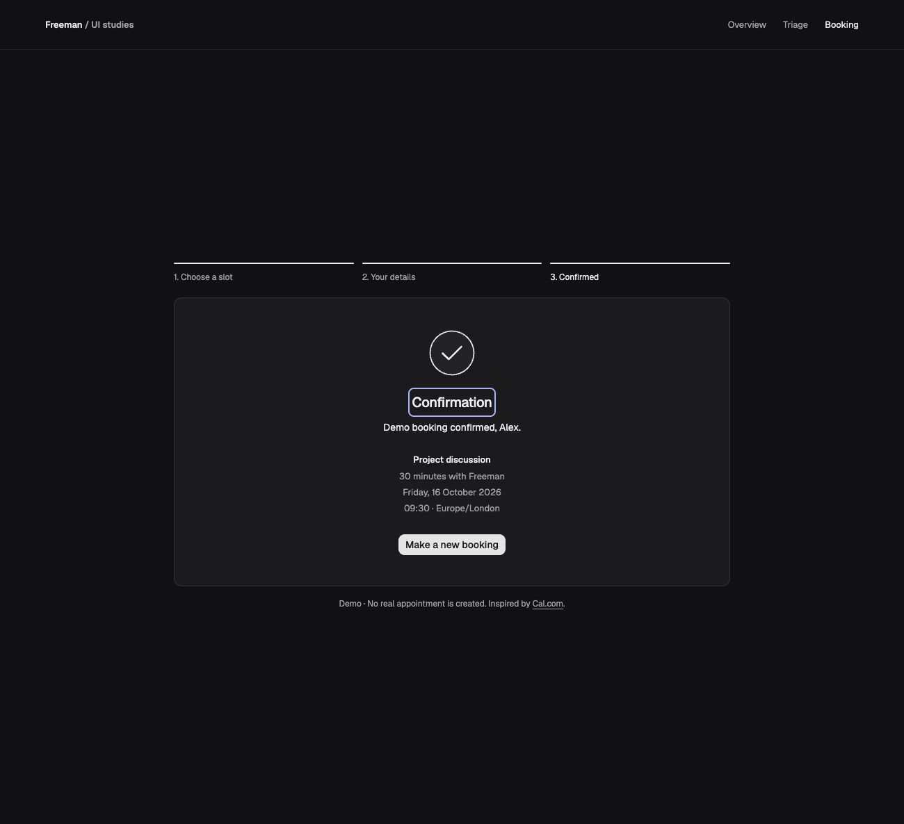
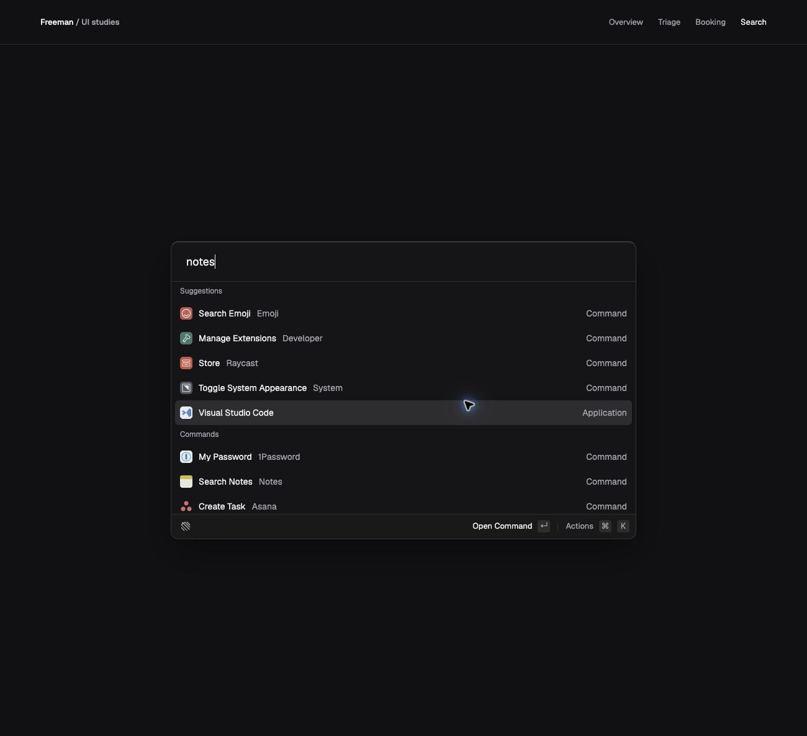
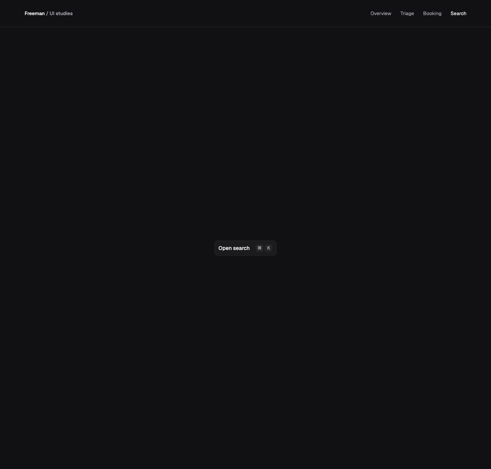

# UI studies — an interaction showcase

I rebuild focused interactions, then refine how they feel through layout, motion, and keyboard use. This app contains three studies: a Linear-inspired Triage inbox, a Cal.com-inspired Booking flow, and a Raycast-inspired Search study.

Share a specific study:

| Documentation | Direct link |
| --- | --- |
| UI builds showcase | [Repository overview](https://github.com/Freeman-md/ui-builds#readme) |
| Triage inbox | [Triage design, motion, and keyboard decisions](https://github.com/Freeman-md/ui-builds#triage-inbox) |
| Booking flow | [Booking design and animation decisions](https://github.com/Freeman-md/ui-builds#booking-flow) |
| Search and actions | [Search design decisions](https://github.com/Freeman-md/ui-builds#search-and-actions) |

## Contents

- [Triage inbox](#triage-inbox)
- [Booking flow](#booking-flow)
- [Search and actions](#search-and-actions)
- [Shared foundation](#shared-foundation)
- [Run locally](#run-locally)

## Triage inbox

Inspired by Linear’s [Triage](https://linear.app/docs/triage) and [Peek](https://linear.app/docs/peek). Open `/triage` to try ten fictional Engineering items, five Design items, and team creation. State resets on refresh.


### Design decisions

- **Flush active tabs.** Match the content surface, remove the inset highlight, and keep side borders so the selected team feels connected to its inbox.
- **Expand in both directions.** Give opened details more height as well as width, with a roughly 25/75 list/detail split. On phones, details replace the list.
- **Peek before opening.** Hover or focus a row for its muted identifier, title, brief, and age. Enter opens full details; moving into the preview keeps it open.
- **Discoverable keyboard controls.** Keep contextual hints and a shortcut guide in the footer. Restore row focus and scroll position when closing details.
- **Keep the shell steady.** Fix the heading and team strip while rows scroll. Create teams through a focused name dialog; new teams start empty.

| Before: inset tab | After: connected surface |
| --- | --- |
|  |  |

### Motion and keyboard

- Move Peek and the selection highlight together over 300ms, including during arrow-key navigation. Retarget from the current position during repeated input.
- Fade old details out completely for 100ms before the next item slides in over 200ms. Direction follows list order; actions stay anchored.
- Respect reduced motion and resolve rapid navigation to the latest selection.

Use **↑/↓** or **J/K** to navigate items, **Enter** to open, **Esc** to return, and **←/→** on team tabs. **N** creates a team, **F** favourites it, **C** copies an open item’s ID, and **?** opens the [shortcut guide](notes/images/11-shortcuts.jpg). Letter shortcuts pause in forms and dialogs and stay scoped to the inbox.

I learned that following the correct row is only half the interaction: the preview also needs to travel there smoothly.

## Booking flow

Inspired by [Cal.com’s custom slots demo](https://demo.cal.com/api-slots). Open `/booking` for a **30-minute project discussion with Freeman**: choose a slot → enter details → confirmation.

### Design decisions

- **One continuous availability surface.** Seven day columns beneath a weekly header, compact time buttons, brighter hover borders, and a prefixed selection checkmark. Empty days show “No availability.”
- **Separate selection summary.** Place a bordered card 12px below availability, with a circled calendar icon, date, time, and actions. Keep it visible during details; remove it on confirmation to avoid duplication.
- **Preserve context on Back.** Retain name, email, optional project note, week, and chosen slot. Return keyboard focus to that slot.
- **Minimal progress, stable frame.** Three slim segments above one fixed-height body: 416px on desktop, 400px on mobile. Longer content scrolls inside; mobile availability scrolls horizontally with a visible hint.
- **Confirm only after success.** Validate required fields, focus the first error, and show pending feedback during a 700ms simulation. Prevent duplicate submissions. Confirmation includes meeting details and a fresh-booking action that resets the flow.

| Details and retained selection | Confirmation without duplication |
| --- | --- |
|  |  |

### Animation decisions

- **Draw progress.** Fill each newly reached segment left to right over 300ms; retract on Back.
- **Make direction clear.** Fade the old week or step out for 100ms, then slide the next in over 200ms. Forward enters from the right; Back enters from the left. Keep the frame and week controls steady.
- **Reveal the summary downward.** Expand, fade, and slide it in over 300ms; reverse on dismissal. Keep the card open when changing slots.
- **Animate only changed values.** Flip the summary time vertically; fade its date only when the day changes. Keep the icon, timezone, and card anchored.
- **Sequence confirmation clearly.** Draw the checkmark, then reveal the heading, personal confirmation message, meeting title, duration/host, date, time/timezone, and restart button in order. Each reveal starts when the preceding animation finishes, with no added pauses. Only duration/host and date typewrite; the remaining text flips in, with a slight rise on the confirmation message.
- **Soften validation.** Expand and fade inline errors in; collapse and fade them out without resizing the outer frame.
- **Keep motion accessible.** Reserve the final text layout, expose complete text to screen readers, and make exiting content unfocusable. Reduced motion removes delays and effects; focusing the restart button reveals the remaining confirmation immediately.

The weekly layout and selection-summary pattern came from the inspected reference. The three-step flow, fixed frame, state preservation, and motion choreography are my choices. The [reference review](notes/booking-reference.md) records observations and inspection gaps; its original proposal is broader than this implementation.

**Demo limits:** fictional London wall-time availability, a fixed Europe/London label, and no real bookings or emails. Past dates and elapsed times are excluded. There is no timezone picker, external calendar, or interactive slot-conflict scenario.

I learned to judge the whole sequence after a fresh reload: extra pauses between short reveals made confirmation feel unnecessarily slow.

## Search and actions

Inspired by Raycast’s [July 2022 desktop refresh](https://www.raycast.com/blog/launch-week-summary), studied first in [Paper](https://app.paper.design/file/01M54DTB6H2SHC0YYVR2TEN8CD/p-1-0). Open `/search` to launch grouped sample results, with **Store selected initially**.

- **Keep the shell quiet.** A centered 750×480px container, 12px corners, and a 64px input row. An 18% neutral tint and 24px backdrop blur let the actual page background show through; no opaque surface gradient. The light edge defines the shell while text stays opaque.
- **Follow the reference’s density.** Suggestions and Commands groups, 20px icons, inline source labels, and aligned trailing result types. Rows are 40px on desktop and 48px on mobile; longer lists scroll inside the shell.
- **Search without losing selection.** Match result titles and sources as you type, ignoring case and surrounding spaces. Hide empty groups; retain the selected match or select the first result. Arrow keys wrap through matches. Show “No results found” with Actions disabled when empty; clearing restores the list. Store is selected on a fresh visit. The simplified SVG icons come from the Paper study.
- **Anchor the action hints.** A 40px footer beneath the scrolling results, with the reference’s simplified mark, “Open Command” ↵, and “Actions” ⌘ ↵ (Ctrl ↵ on Windows/Linux). It grows to 48px on mobile. Actions opens the panel; Open Command remains disabled until execution is implemented.
- **Keep actions contextual.** A 360px-wide panel, about 280px tall before filtering, above Actions, with the selected result title, grouped action rows, aligned keycaps, and search at the bottom. Click Actions or press ⌘ Enter / Ctrl Enter to toggle; Esc restores trigger focus and an outside click dismisses. Arrow keys navigate actions. Mobile narrows the panel and uses 48px rows. Changing result selection closes the panel and resets its action query, so actions never retain stale context.
- **Filter without losing context.** Match action names as you type, ignoring case and surrounding spaces. Hide empty groups, select the first match, and keep arrows within the matches. Contract the panel around results; show “No actions found” when empty, with a live result count for assistive technology. Clearing restores all four actions.
- **Let the highlight travel.** Search results and Action Panel rows reuse Triage’s 300ms easing and a shared highlight component. Hover moves the highlight without committing selection; leaving returns it to the selected row. Keyboard navigation takes over immediately. Each list has its own motion scope, and reduced motion removes travel.
- **Ease the panel in and out.** Fade in with a 6px rise over 200ms; fade out with a 4px drop over 200ms. Reuse the shared easing and timing, keep exiting content inert until removal, and disable the transition for reduced motion.
- **Make filtering flow.** Fade removed matches out for 100ms, then reposition rows and fade new matches in over 200ms, without a stagger. Empty states use the same sequence. Animate the panel’s measured content height over 200ms while its bottom edge stays anchored. Queries, selection, and live counts update immediately; exiting rows are inert. The outer Search frame stays fixed, and reduced motion removes delays.
- **Launch on demand.** Desktop starts with an Open search button; ⌘ K / Ctrl K toggles Search. Reuse the 200ms fade/rise and fade/drop, focus the input on entry, and return focus after exit. Esc closes Actions first, then Search; the input also has an Esc button. Closing preserves the query and selected result. Below 640px, Search stays open without launcher or close controls. Reduced motion removes the transition.
- **Keep focus styling intentional.** Search inputs, rows, and controls use transparent default rings and focus-only borders. The moving row highlight remains the keyboard navigation indicator; shared input validation keeps its error styling.

| Before: always visible | After: desktop launcher |
| --- | --- |
|  |  |

[Open Search](notes/images/42-search-open.png) · [Always-open mobile Search](notes/images/42-search-mobile.png) · [No results](notes/images/38-main-empty.png) · [Resized panel](notes/images/41-resized-panel.png). Command execution remains for later; action rows only change selection. Shortcut labels within action rows are visual hints. The four actions follow Paper’s Store fixture; the panel heading follows the selected result. Paper’s compact filtered state was a behavior reconstruction with inferred dimensions; case matching, empty feedback, keyboard handling, and motion are implementation choices.

Glass falls back to an opaque surface without blur support or when reduced transparency/high contrast is requested. A uniform dark backdrop offers no distinct detail to blur, so the glass remains subtle; no artificial wallpaper or coloured reflection is added. This is a visual study, not an operating-system launcher or an exact native-material replica.

## Shared foundation

React, TypeScript, Vite, Tailwind CSS, shadcn/ui with Base UI, Motion, and Lucide icons. Shared control focus indicators use neutral muted-foreground. Input and Textarea focus outlines/rings are transparent by default; individual fields can opt into a visible treatment. Validation styling remains separate.

| Study | UI primitives |
| --- | --- |
| Triage | Card, Tabs, Dialog, Popover, Item/ItemGroup, Toggle, Tooltip, Button, Badge, Input, Label |
| Booking | Button, Input, Label, Textarea; custom availability, progress, and confirmation layouts |
| Search | Card, Input, Item/ItemGroup, ItemMedia, ItemContent, ItemActions, Button, Kbd/KbdGroup, Popover |

Feature hooks own state and interactions; components handle presentation. All three studies share [motion easing/timings](src/lib/motion.ts), while their choreography stays local. Search reuses Triage’s moving-highlight pattern for both lists.

- `src/features/triage/`, `src/features/booking/`, and `src/features/search/`: separate study components, with hooks and fixtures where needed.
- `src/components/ui/`: shared primitives; `src/index.css`: shared theme and accessibility defaults.
- `src/App.tsx` and `src/showcase.css`: showcase navigation and layout.

`/` is the showcase. Navigation resets each study’s session state. Production hosting must serve `index.html` for app routes. The repository retains its original `triage-inbox` name; no npm package has been published. Local reuse can later be tested with `npm pack`.

## Run locally

```sh
npm install
npm run dev
```

```sh
npm test        # Search selection/filtering, shortcuts, and booking boundaries
npm run build   # Type checking and production build
npm run lint
```

Detailed design communication notebooks stay local and Git-ignored; this README contains the condensed decisions and selected before/after images.
