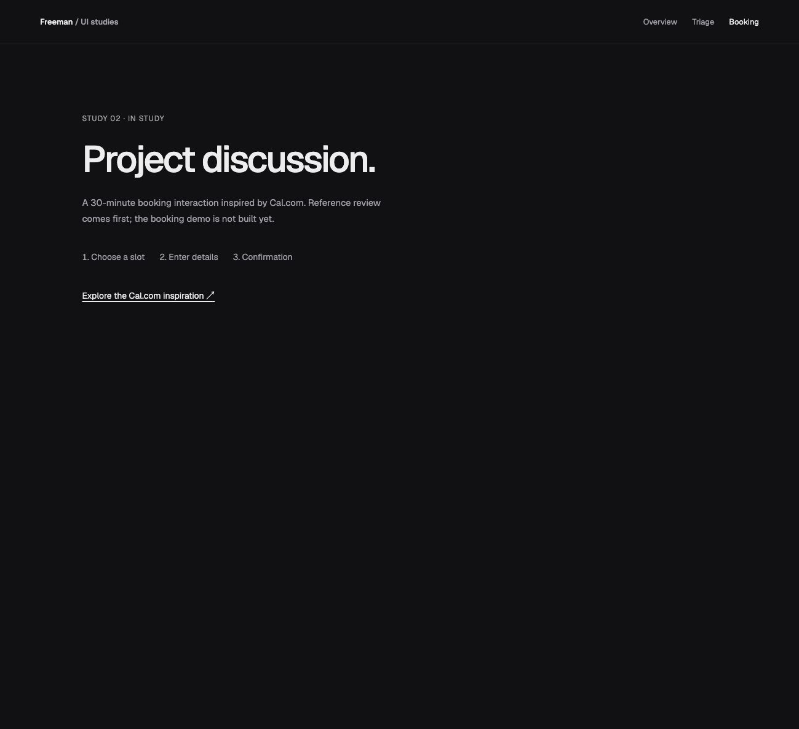
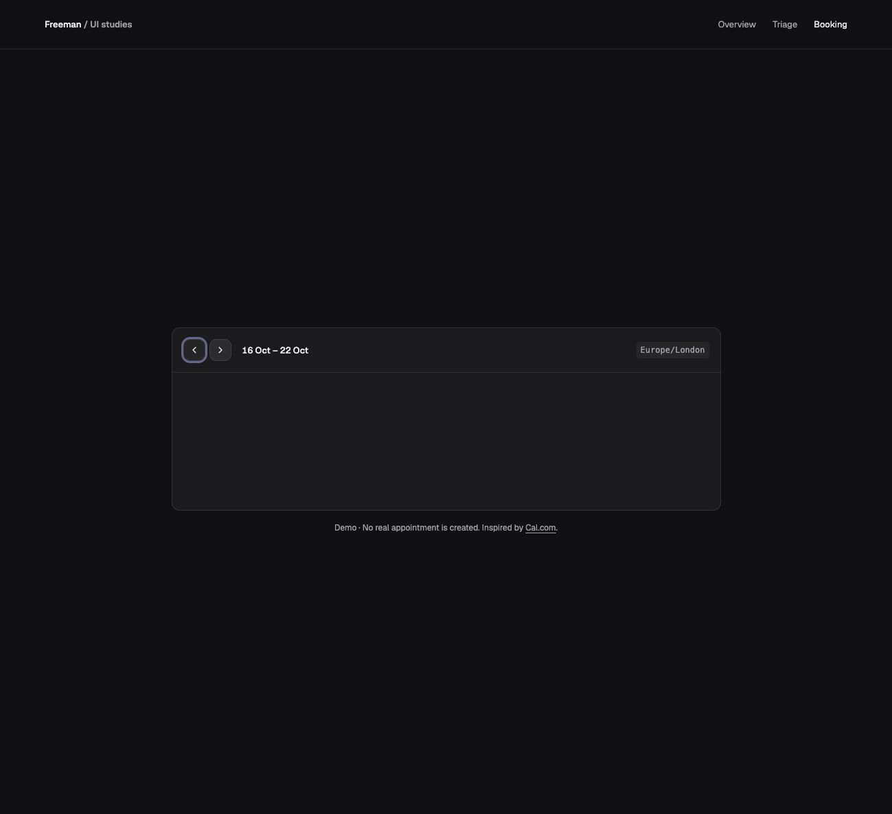
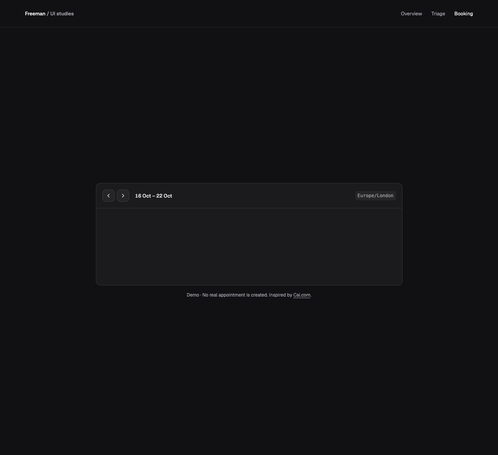
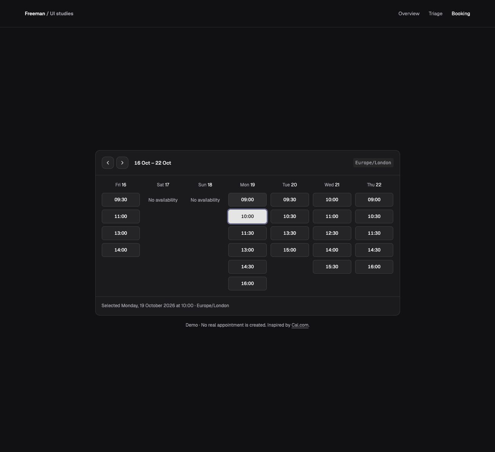
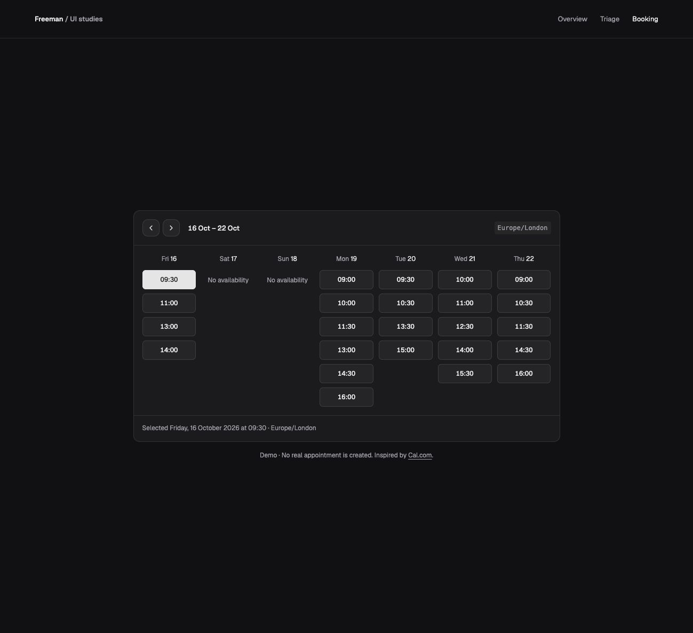
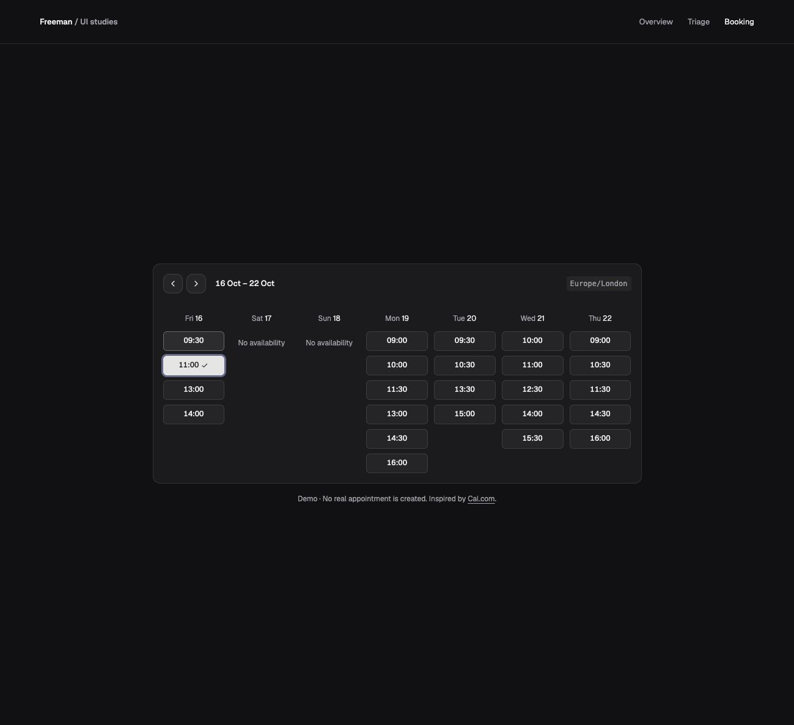

# UI studies — an interaction showcase

This app collects my interaction studies. `/` is the showcase, `/triage` is the working inbox, and `/booking` has weekly sample availability and selectable times. Details and confirmation are still to come.

The repository directory and GitHub remote retain the original `triage-inbox` name. No package has been published.

## Triage inbox

I rebuilt Linear’s [Triage](https://linear.app/docs/triage) and [Peek](https://linear.app/docs/peek) interactions to practise making design decisions and communicating them precisely. I started with a blank container, then refined the layout, previews, motion, and keyboard behavior one step at a time.

This is a local prototype with fictional items: ten in Engineering and five in Design. I can create more teams, but everything resets on refresh.


## Four design decisions

### 1. Make the active tab part of the content surface

I replaced the inset highlight with a full-height, flush tab. Its background matches the body, with borders on the left and right, so the selected team feels connected to its inbox.

| Before | After |
| --- | --- |
|  |  |

### 2. Expand in height as well as width

Opening an item expands the container into a roughly 25/75 list-and-detail layout. I also gave it more height so the details have room to read. Closing it restores the list’s scroll position and row focus; on phones, details replace the list.

| Before: width only | After: width and height |
| --- | --- |
|  |  |

### 3. Let people Peek before opening

I added a compact preview for a quick read without expanding the workspace. Hovering or focusing a row reveals its identifier, title, short brief, and age. Enter opens the full details; moving the pointer into the preview keeps it open.

| Before | After |
| --- | --- |
|  |  |

### 4. Make keyboard controls discoverable

I put contextual key hints in a persistent footer, with a clickable shortcut guide. Navigation works through the list and details, while letter shortcuts stay scoped to the inbox and pause in forms and dialogs. Visible focus and selection announcements support the same flow.

| Before | After |
| --- | --- |
|  |  |

Use **↑/↓** in the list, **J/K** for next/previous, **Enter** to open, and **Esc** to return. **←/→** switches focused team tabs. **N** creates a team, **F** favourites it, **C** copies an open item’s ID, and **?** opens the [complete guide](notes/images/11-shortcuts.jpg).

## Animation decisions

- **Keep Peek connected to selection.** I wanted the preview to travel up or down with the row highlight, including during arrow-key navigation. It now glides between anchors over 300ms using the same easing as the highlight. First opening and closing keep their own short transitions.
- **Let the old details leave first.** Showing two descriptions at once felt visually busy. I chose a complete 100ms fade-out before the next item slides in over 200ms. The slide direction follows list order, while the container and action buttons stay anchored.
- **Stay responsive during motion.** Repeated navigation retargets Peek from its current position; detail changes resolve to the latest selection. Reduced-motion preferences disable the effects.

## What I learned

Describing edges, proportions, direction, and timing made my feedback easier to implement. A preview’s position and its movement are separate decisions: following the correct row still felt abrupt until the surface travelled between rows. I also learned to judge exits and entrances together, rather than making each animation smooth in isolation.

## Components and structure

I used React, TypeScript, Vite, Tailwind CSS, shadcn/ui with Base UI, Motion, and Lucide icons.

| shadcn/ui components | Where I used them |
| --- | --- |
| Card, Tabs | Workspace shell and team selection |
| Dialog, Input, Label | Team creation and the shortcut guide |
| Popover | Peek |
| Item, ItemGroup | Two-line triage rows |
| Toggle, Tooltip | Team favourites and control hints |
| Button, Badge | Detail actions and properties |

The footer’s keycaps use native `<kbd>` elements. Team state, selection/focus restoration, and Peek behavior live in focused hooks. Both sample teams reuse the same inbox and detail components with different fixture data.

## Booking — weekly availability

Inspired by [Cal.com's custom booking demo](https://demo.cal.com/api-slots).

- Start with a rolling seven-day range beginning on today's date in London, matching the reference layout.
- Group previous/next arrows with the date range; keep Europe/London as a fixed label on the right. There is no timezone picker in this slice.
- Navigate in calendar days so daylight-saving changes do not shift the displayed week. Announce range updates without moving keyboard focus.
- Show seven date columns with varied fictional 30-minute times; empty days say “No availability.” Past dates and elapsed London times are not offered.
- Brighten slot borders on hover; mark the selected time with a checkmark and announce its date/time. Use compact rectangular buttons with visible keyboard focus.
- Keep the header and slots on one continuous surface without an internal divider. A separate selection summary is planned; only the screen-reader announcement remains in this slice. Changing weeks clears selection.
- Keep columns readable on mobile through a keyboard-focusable horizontal scroll region and a visible scroll hint. Small screens wrap the timezone label as needed.

| Before | After |
| --- | --- |
|  |  |

Weekly slots:

| Before | After |
| --- | --- |
|  |  |

[Mobile view of the initial grid](notes/images/16-weekly-slots-mobile.png).

Slot refinement:

| Before | After |
| --- | --- |
|  |  |

These fixture times are London wall times, not bookings or availability from an external calendar. The layout follows Cal.com's weekly demo; selection feedback, fixture schedules, and mobile scrolling are choices for this study.

## Other Triage decisions

- Create teams with a focused name dialog; new teams start with an empty inbox.
- Keep the heading and team strip fixed while the two-line item list scrolls.
- Keep the item identifier muted above the Peek title.
- Keep state and interaction logic in focused hooks, separate from presentation.

## App structure

- `src/features/triage/`: inbox components, hooks, fixtures, shortcuts, and motion styles.
- `src/features/booking/`: week header, seven-day slot grid, fixture availability, calendar-day helpers, and selection state.
- `src/components/ui/`: shared shadcn primitives. React component filenames use PascalCase; hooks and utilities retain their existing naming convention.
- `src/index.css`: shared theme and accessibility defaults.
- `src/App.tsx` and `src/showcase.css`: showcase navigation and study pages.

Study links use ordinary browser navigation; leaving a study resets its session-only state. Triage loads separately from the overview. A production host must serve `index.html` for `/triage`, `/booking`, and other app paths.

The [Booking reference review](notes/booking-reference.md) distinguishes observed Cal.com behavior from proposed choices. Reuse can be tested with a local package using `npm pack` and installing the resulting tarball in another app; public npm publication is a later step.

## Run locally

```sh
npm install
npm run dev
```

```sh
npm test        # Shortcut behavior and booking date boundaries
npm run build   # Type checking and production build
npm run lint
```

Design decisions and before/after images live in this README for each study. Detailed communication notebooks stay local and Git-ignored; they guide these condensed public summaries.
