# Design communication notes

## 1. Scaffold the container

**Original wording (excerpt)**

> The most important thing we're working on is we just want the container and then the highlighted team and, what do you call it, the plus icon to add a new team, if you follow me. This container is just going to be a small container.

**Precise version**

> Set up React, TypeScript, Tailwind CSS, and shadcn/ui at `ui-builds/triage-inbox`. Build a compact, centered container with a selected Engineering tab and an adjacent plus button labelled “Add team.” Leave the body blank and include accessible labels and keyboard focus.

**Result**

Centered dark container with the Engineering tab, inactive plus button, and blank body. Commit: `1624f4a`.

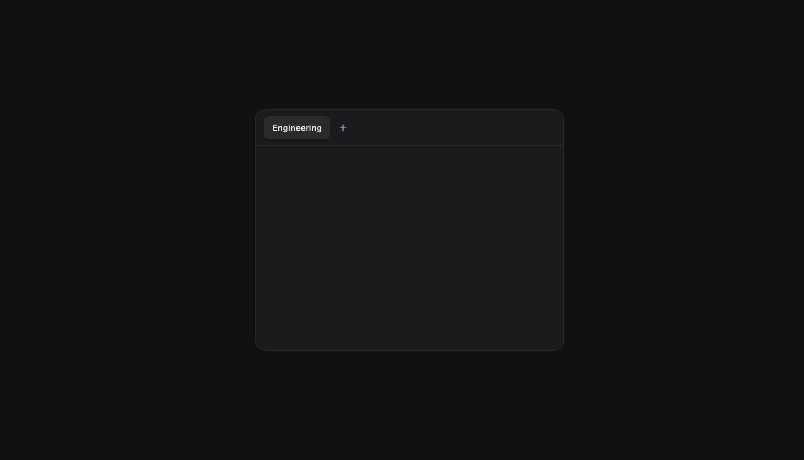

## 2. Join the active tab to the body

**Original wording (excerpts)**

> It's as if the active this thing starts from the, you know, like it's as if it is sitting on top of the content area, such that you don't see. It's as if it is a continuation. Something like that.

> It is activated not by elevating it, but by, you get, as if it continues from the content area straight to the top of the heading. You get? And the heading of the this thing is a bit more shorter.

**Precise version**

> Make the active tab flush with the header’s top and bottom. Match its background to the body, with only left and right borders, so both surfaces appear continuous. Darken and shorten the header. Add the left sidebar icon and “Engineering › Triage” label. Keep the body blank.

**Result**

Shorter, darker header with a full-height active tab joined to the body, plus the icon and label. Commit: `22e7a69`.

Before:

After:

## 3. Create a team

**Original wording (excerpts)**

> I think a simple modal would make more sense. You get a simple modal and then just name, enter the name, enter. It creates a new team.

> Triage remains the default breadcrumb item. Keep the body blank, update the notes with this design step, and commit it when you're done.

**Precise version**

> Open a compact “Create team” dialog from the plus button, with a focused, labelled name field. Submit with Enter or Create team, reject blank and duplicate names, then add and select the new team tab. Keep “Triage” in every tab’s breadcrumb and the body blank. Support Cancel, Escape, and focus restoration to the plus button.

**Result**

Accessible creation dialog and selectable team tabs, with validation and overflow handling. Verified Enter/button submission, cancellation, focus trapping/restoration, and narrow-screen layouts. Teams last for the current page session. Commit: `feat(triage): add accessible create-team dialog`.

Before:

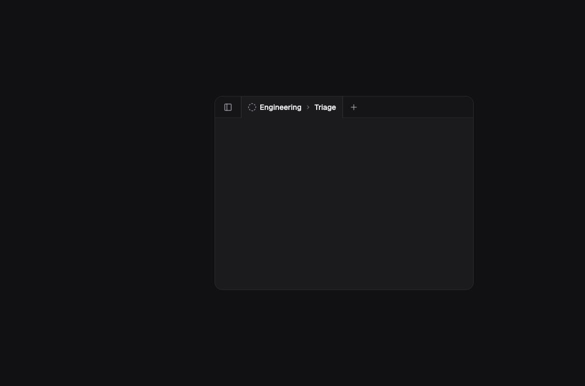

Dialog:

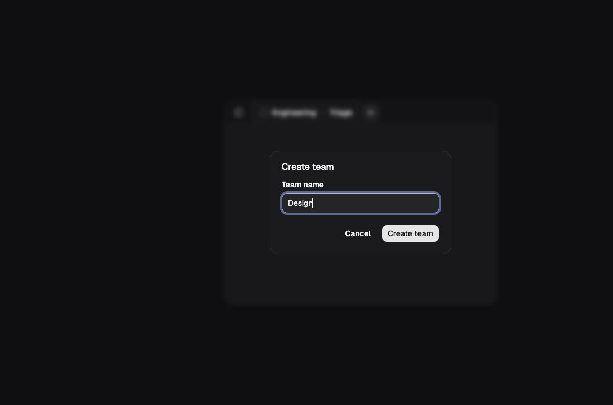

After:

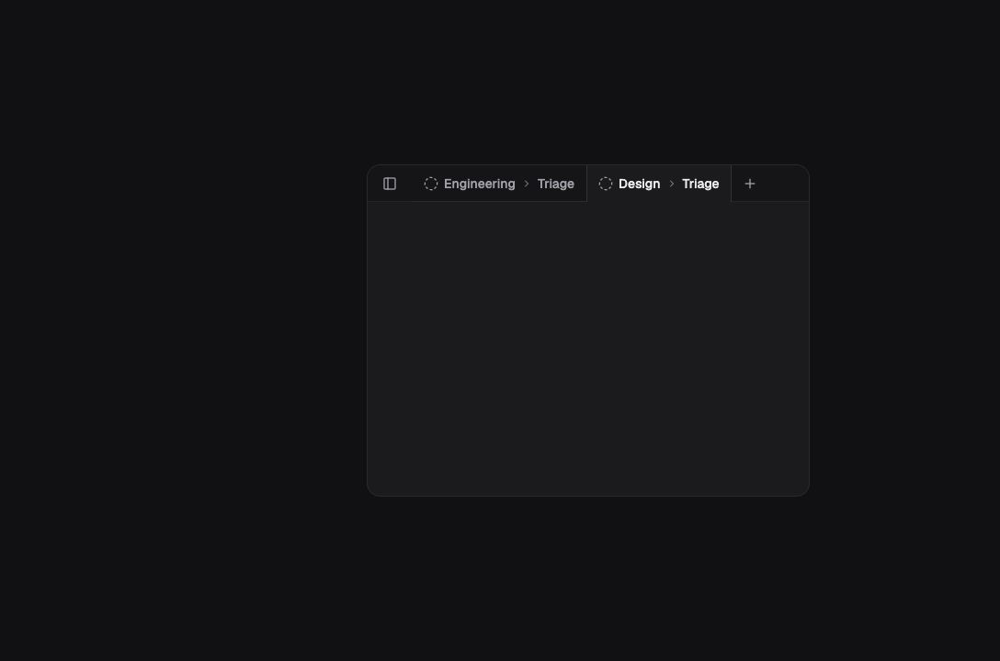

## 4. Add the Triage heading and sample list

**Original wording (excerpts)**

> For a list item, I can see that it's got, let's say, two rows. I don't know how it was implemented though, but I know in the first row we have the title and justified to the right of it we have the identifier for that particular item. Below we have the source and then to the right of the source we have the age of the item, and I think we can use maybe like ten dummy items.

> And then also they are all filled to the left and right.

**Precise version**

> Add a full-width Triage heading with an inbox icon and star toggle. Below it, show ten edge-to-edge sample gigs: title left and identifier right, then source left and age right. Give the list a slightly lighter background and subtle row separators. Keep the heading fixed while the list scrolls; leave new teams empty and defer details and Peek.

**Result**

Ten two-line gigs in Engineering, keyboard-scrollable list, and independent star state per team. Verified scrolling to the final item, star toggling, team switching, and mobile layout. Commit: `feat(triage): add inbox heading and sample gig list`.

Before:

After:

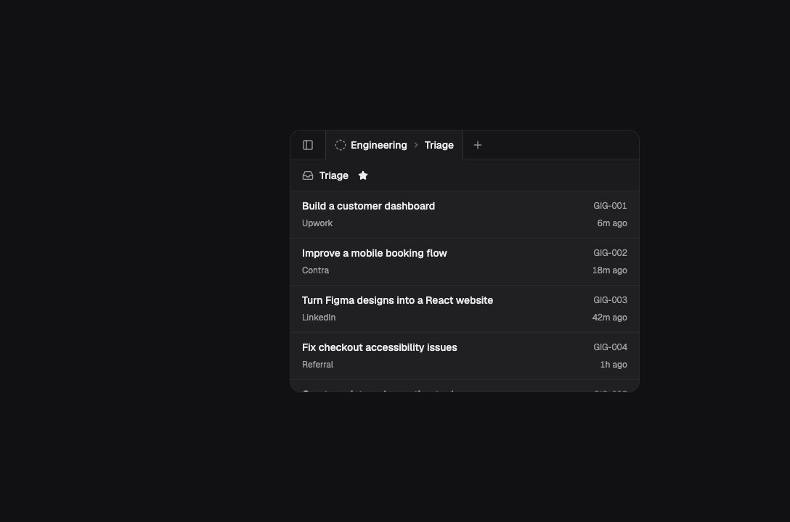

## 5. Separate team logic and fix header scrolling

**Original wording (excerpts)**

> If possible, can you move those into hooks, or is it prefer?

> such that when we start having functionalities like viewing the details of an item, we wouldn't want to put it in the same component, or in the same app.tsx file.

> It scrolls. I don't know, like it scrolls vertically.

**Precise version**

> Extract team state, creation, selection, and favourite actions into a focused hook. Keep tab rendering and its DOM scroll effect in a team-header component, leaving App.tsx to compose the UI. Prevent vertical scrolling in the team strip while preserving horizontal overflow and keyboard navigation.

**Result**

Added `useTeams` and `TeamHeader`. Removed the unused tab underline and constrained vertical overflow: content height now matches the 40px strip instead of extending to 45px. Verified creation, duplicate validation, favourites, team switching, and mobile keyboard navigation. Commit: `fix(triage): isolate team logic and prevent vertical tab scrolling`.

Before:

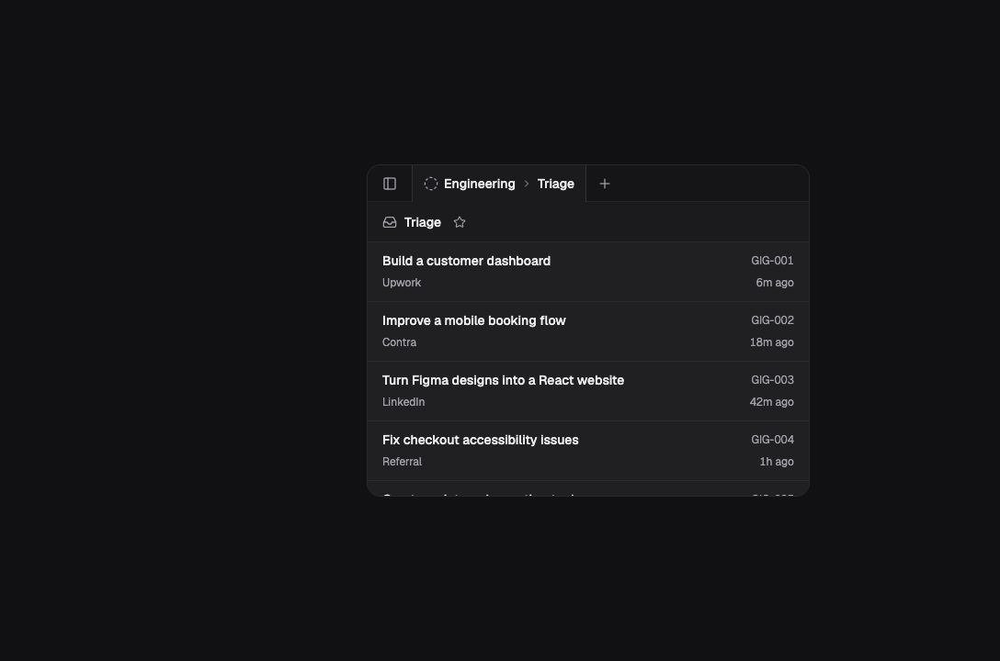

After:

## 6. Open triage details

**Original wording (excerpts)**

> We want when I click on a detail, it should be highlighted, of course maybe a bit darker. And then the details should open to the right. It's more like that container is extending to the right, and the details is gonna take up three-quarters of maybe the container's full width.

> The most important thing is, while I want you to do this, the most important thing is the animations, the transitions, how seamless it is, how, do you get what I'm trying to say?

**Precise version**

> Make rows selectable and darken the selected row. Smoothly expand and recenter the container into a 25/75 list-and-detail layout. Show the identifier, title, copy and close actions, badges, brief, and requirements. Preserve list scroll and restore focus on close; support keyboard input, a mobile Back flow, and reduced motion. Defer Peek.

**Result**

Added a selection hook and separate workspace/detail components. The split uses a 260ms transition; mobile shows details in place of the list. Verified switching, Copy identifier, Escape/Back, exact scroll and focus restoration, team changes, and narrow layouts. Commit: `feat(triage): add expanding split detail view`.

Before:

After:

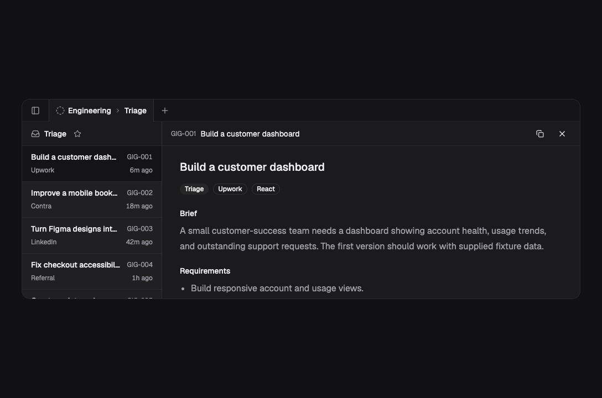

## 7. Expand details vertically too

**Original wording (excerpt)**

> I think you should expand it height-wise as well. Like, it should maybe, like—I mean, there should be more like a minimum height that is still bigger than the existing container height, do you get the potential to make.

**Precise version**

> Expand the detail container in height as well as width. Use an expanded body height of roughly 480–560px where space allows, capped to fit shorter screens. Coordinate both transitions and preserve list position and focus when closing.

**Result**

The expanded body grows to 504px on a 720px-high desktop viewport and fits shorter mobile screens. Verified height animation, Escape/Back, focus, and restored list scroll. Build and lint pass. Commit: `fix(triage): restore vertical detail expansion`.

Before:

After:

## 8. Peek with hover and keyboard support

**Original wording (excerpts)**

> You see picking is just basically it's going to show the title and then just the brief detail, and then just maybe the age. Keep it very precise. It shouldn't be too long.

> Such that if I'm picking at one, I can click on down, and it goes to the next one. I can pick on the next one, and maybe possibly I can press Enter, and then it opens, expanded into a full, which is why we need to ensure that the expansion is larger.

**Precise version**

> Show a compact Peek on row hover or keyboard focus, containing the title, a three-line brief, and age. Up/Down changes the preview; Enter opens full details; Escape dismisses Peek. Keep focus in the list and let the pointer enter the preview. Hide Peek while details are open.

**Result**

Added a non-modal shadcn Popover and focused Peek hook. Verified hover, pointer entry/exit, keyboard navigation, Enter, Escape, focus restoration, narrow layouts, and team creation. Build and lint pass. Commit: `feat(triage): add hover and keyboard peek`.

Before:

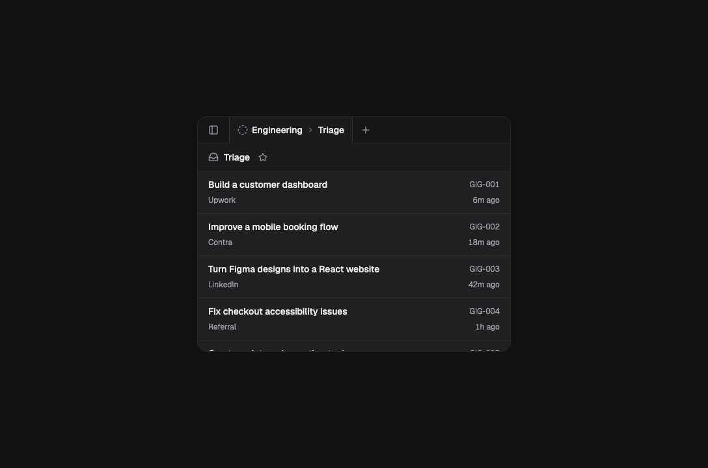

After:

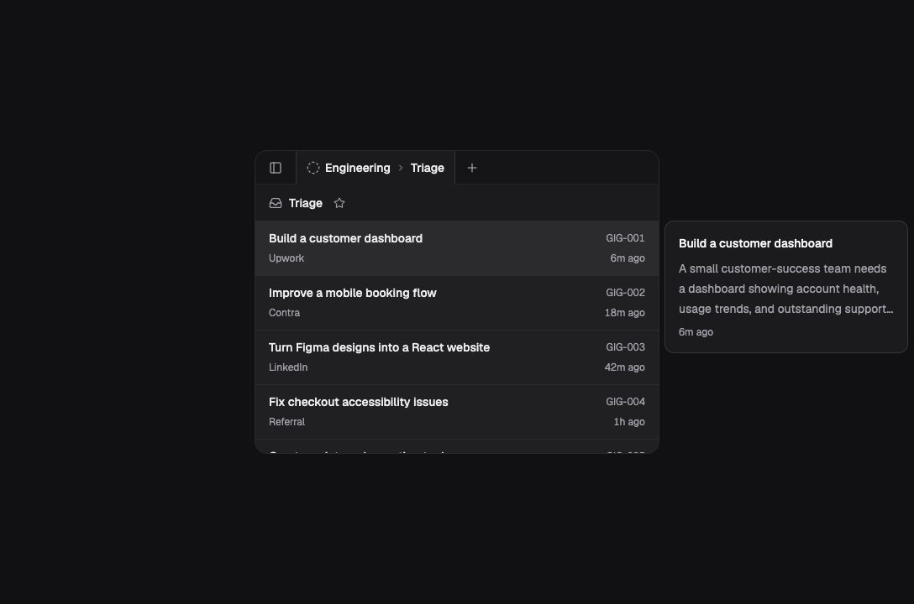

## 9. Add the Peek identifier

**Original wording (excerpt)**

> Just add that identifier at the top before the title. Gray out a little bit.

**Precise version**

> Add the item identifier above the Peek title in smaller, muted gray text. Keep the existing layout and behavior.

**Result**

Added the identifier above the title and to keyboard announcements. Visually verified placement and contrast; build and lint pass. Commit: `style(triage): show identifier above peek title`.

Before:

After:

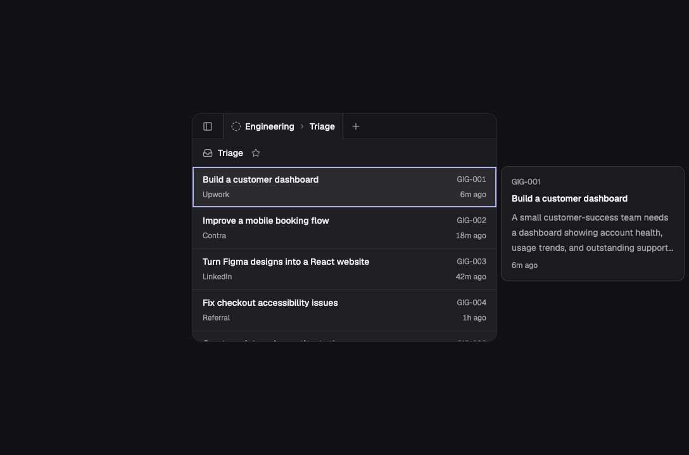

## 10. Coordinate selection and team transitions

**Original wording (excerpts)**

> I think the first aspect of it is, you know, when you expand the details of an item, when you move on to the next one, it just changes it.

> when I create a team, I want the entry of the new, the entry of the tile for the new team created should be seamless, and the removal of the content, or rather the list items for that particular team, should be seamless as well.

**Precise version**

> Add brief, interruptible transitions for detail changes, row selection, new team tabs, and team switching using Motion and CSS. Preserve the expansion. Keep keyboard selection immediate and respect reduced motion. Defer new shortcuts.

**Result**

Details fade with a 4px entrance over 160ms; new tabs settle over 180ms; team panels fade over 150ms. Verified rapid switching, creation, Peek, mobile, and scroll/focus restoration. Reduced-motion paths reviewed, not browser-emulated. Build/lint pass; Vite reports a bundle-size warning. Commit: `feat(triage): coordinate detail and team transitions`.

Before:

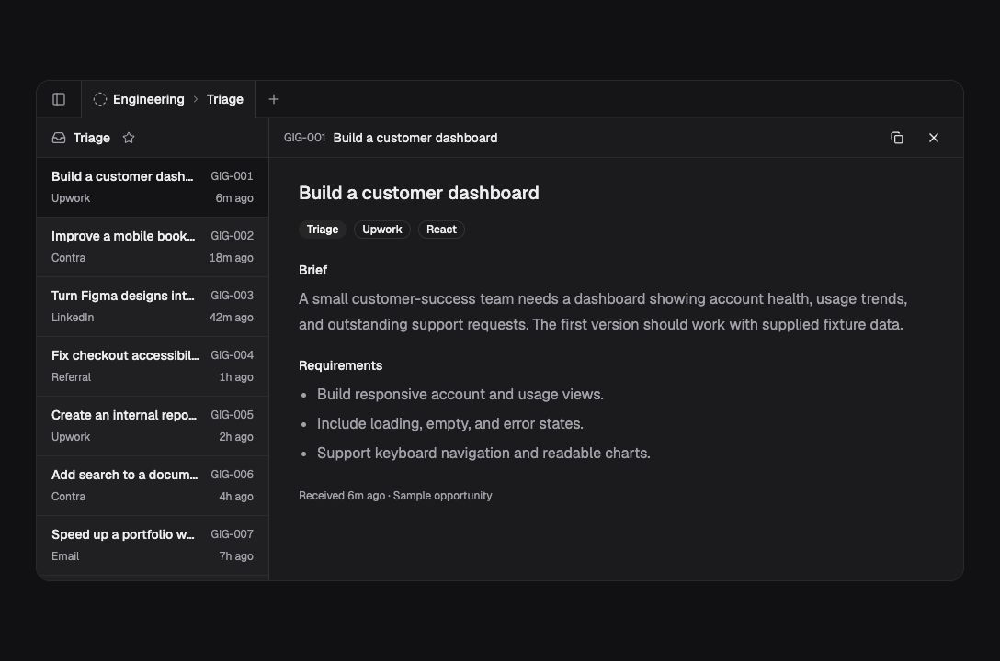

After (settled state):

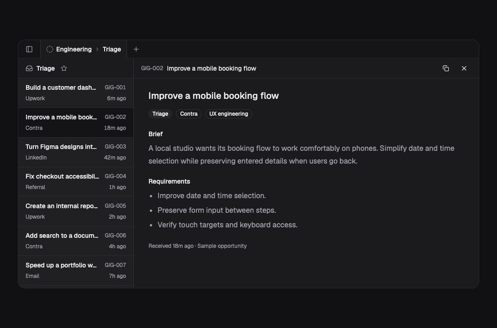

## 11. Directional slides, keyboard guide, and a second sample team

**Original wording (excerpts)**

> If I go down, the highlight should scroll. It should animate down. It should go from the up one to the down one.

> Go ahead and implement the directional slides, moving highlight, and keyboard shortcuts with the footer guide. Keep the expansion as it is, verify everything works, update the notes, and commit it. Also, add an additional fictional team like we have for "Engineering" so I can easily illustrate switching teams without creating a new one, thanks

**Precise version**

> Use reversible 300ms vertical slides for detail changes and move one shared highlight between rows. Preserve expansion. Add scoped navigation/action shortcuts, a contextual footer, and a complete shortcut guide. Seed Design with its own sample items alongside Engineering.

**Result**

Added 48px directional slides, the moving highlight, keyboard controls/help, and five Design items. Verified direction, jumps, rapid input, boundaries, team switching, form/dialog isolation, copy, favourite, focus restoration, and mobile layouts. Four shortcut tests, build, and lint pass. Reduced-motion paths reviewed, not browser-emulated; the existing bundle-size warning remains. Commit: `feat(triage): add directional navigation and keyboard guide`.

Before:

After (settled states):

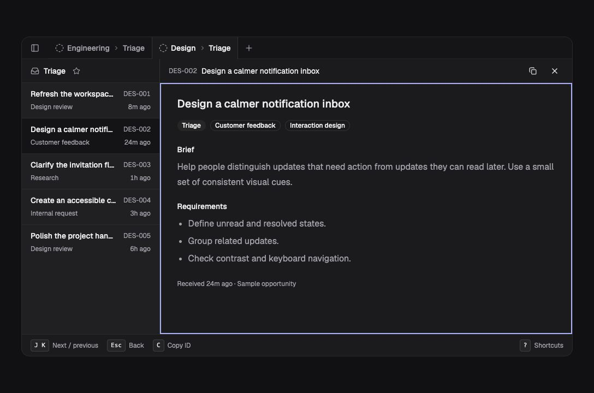

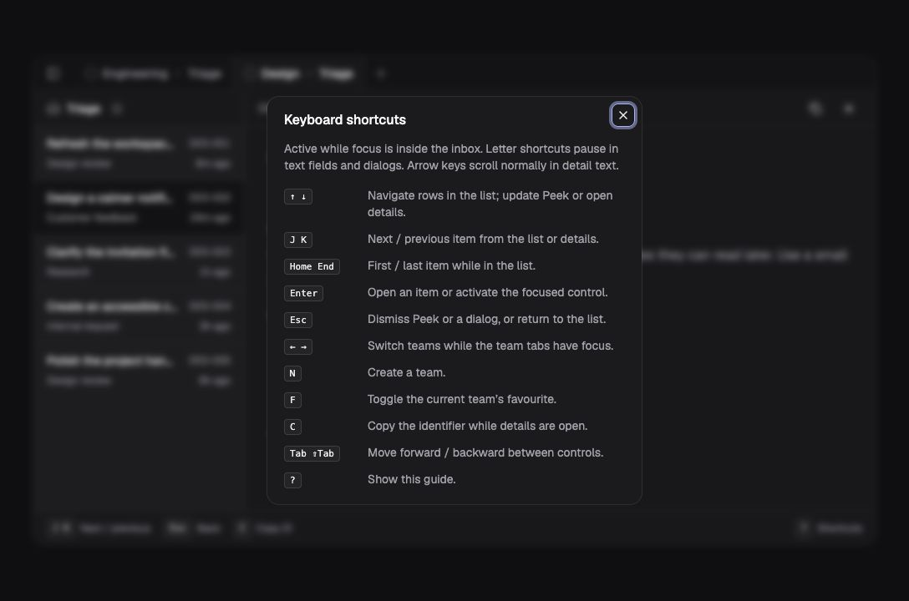

## 12. Separate the detail exit and entrance

**Original wording (excerpt)**

> I think maybe if you can fade the older, the previous item out completely and then transition that one upwards, it will be much smoother, it will be more clearer

**Precise version**

> Fade the previous detail body out fully before sliding the next one in. Preserve directional navigation, the moving highlight, and expansion. Review the repo for focused cleanup and rewrite the README in my voice around four design decisions, with before/after examples.

**Result**

Sequenced a 100ms fade-out and 200ms entrance. Removed the overlap wrapper/positioning and three unused scaffold assets. The README explains flush tabs, taller expansion, Peek, and discoverable keyboard controls, plus components and lessons. Browser checks cover sequencing, rapid navigation, mid-transition close, focus, and mobile. Tests/build/lint pass; the existing bundle warning remains. Reduced-motion paths were code-reviewed. Commit: `fix(triage): sequence detail transitions and document design decisions`.

Before:

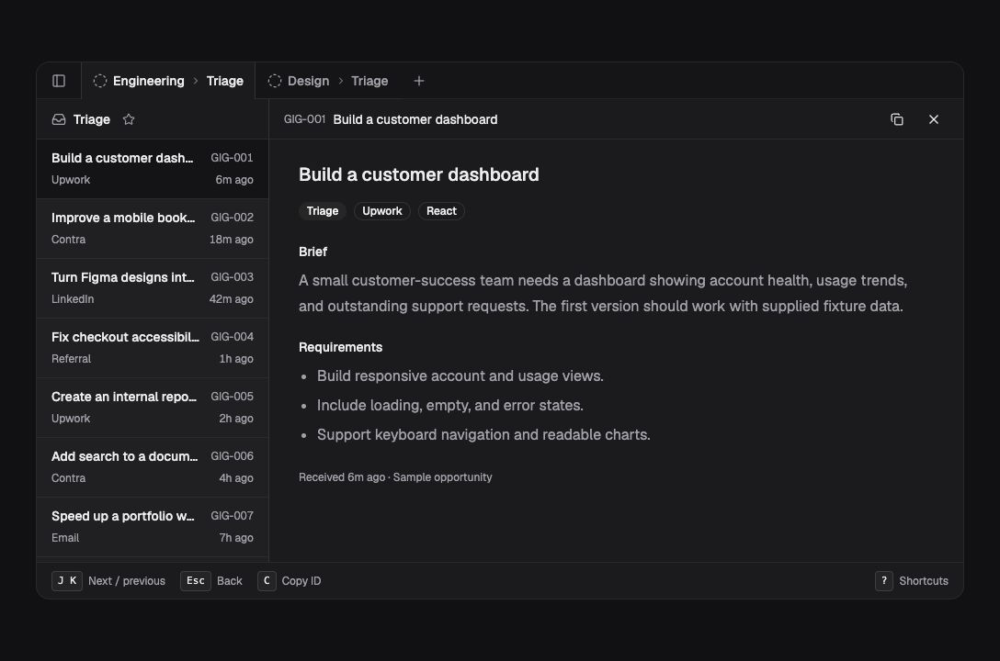

After (settled state):

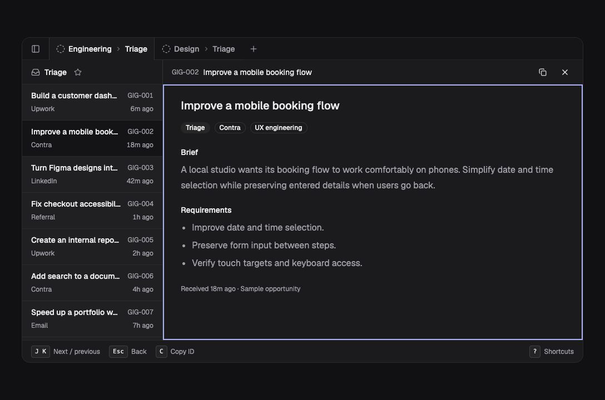

## 13. Let Peek flow with the highlight

**Original wording (excerpts)**

> It should flow, flow up or flow down. You get the point I'm trying to make? Just the same way the highlighter flows up and down.

> when I'm using the arrow to navigate between list items, especially, that's before the details is shown.

**Precise version**

> Animate the Peek surface between row anchors over 300ms, matching the highlight’s easing, for hover and keyboard navigation. Preserve focus, collision handling, and Enter-to-open. Document this decision and the sequential detail fade/slide in the README.

**Result**

Added a transform transition to Peek’s positioning layer. Verified intermediate positions in both directions, rapid reversal, hover/pointer entry, keyboard handoff, scrolled lists, and mobile placement. Tests/build/lint pass. Reduced-motion handling is inherited from the existing CSS rule and was code-reviewed; the existing bundle warning remains. Commit: `fix(triage): glide peek between highlighted rows`.

Before:

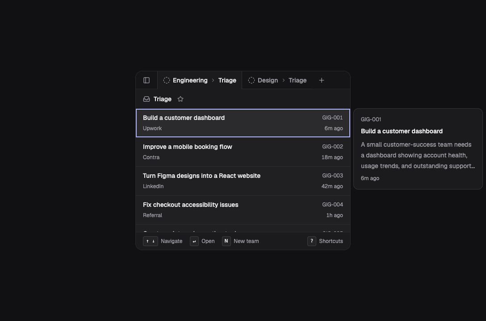

After (settled state):

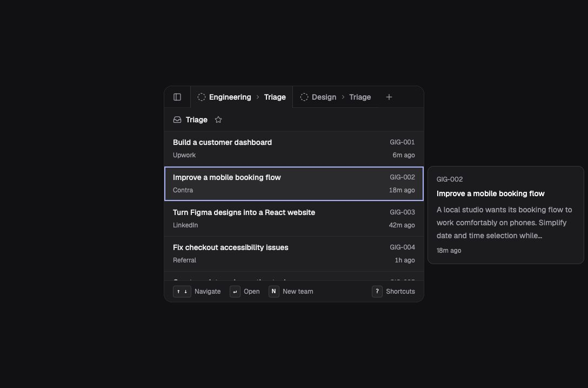
